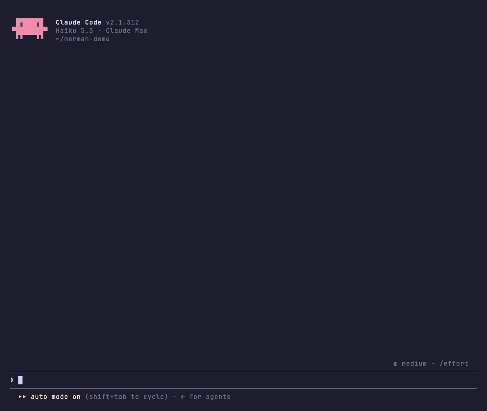

<h1 align="center">merman</h1>

<p align="center"><em>Mermaid diagrams, tables and code, drawn in color right in Claude Code.</em></p>

<p align="center">
  <a href="https://github.com/iamrohithrnair/merman/releases"></a>
  <a href="https://github.com/iamrohithrnair/merman/actions/workflows/ci.yml"></a>
  <a href="LICENSE"></a>
  
</p>

<p align="center">
  <a href="#install"><strong>Install</strong></a> ·
  <a href="#performance">Performance</a> ·
  <a href="#themes">Themes</a> ·
  <a href="#features">Features</a> ·
  <a href="#configure">Configure</a> ·
  <a href="docs/CHANGELOG.md">Changelog</a>
</p>

<p align="center"></p>

## TL;DR

- merman is a Claude Code mod: a plugin of TypeScript hooks that redraws what Claude Code shows on screen. It is not a tool or MCP server, and Claude never calls it.
- Claude Code prints mermaid as source and tool calls as walls of text. merman draws them: real charts and flowcharts, typeset LaTeX math in kitty and Ghostty, colored tables and code, and, if you opt in, quiet tool rows.
- 16 palettes plus `mono`, and copy buttons on everything.
- Clone and link to install, `/plugin` to turn it off. Claude Code's own renderer comes back the moment you do.
- No network calls. It runs a program only when you click `⧉ html` or `▣ png` (the clipboard helper) or turn on LaTeX (RaTeX's renderer).
- A full reply renders in about 2 ms; see [Performance](#performance).

## Install

Requires Claude Code **2.1.311** or later.

1. Clone the repo anywhere you keep code:

   ```bash
   git clone https://github.com/iamrohithrnair/merman.git
   cd merman
   ```

2. Link the checkout into Claude Code's skills folder:

   ```bash
   mkdir -p "${CLAUDE_CONFIG_DIR:-$HOME/.claude}/skills"
   ln -s "$PWD" "${CLAUDE_CONFIG_DIR:-$HOME/.claude}/skills/merman"
   ```

3. Start a new session, or run `/reload-plugins` in an open one. Check it loaded:

   ```bash
   claude plugin list
   ```

   It shows `merman@skills-dir` with `Status: ✔ loaded`.

4. Run `/merman setup` to pick a theme and styles, then `/merman demo` for a tour.

In a terminal, setup opens a pane: the arrows or Tab move through the styles of a step with a preview of the one in focus, Enter saves it and shows the next step. Where the session has no terminal, as in the desktop app, it walks the same steps in the transcript.

### How it loads

Claude Code needs no install command: a folder in `~/.claude/skills/` (`$CLAUDE_CONFIG_DIR/skills/` when that is set) that holds a `.claude-plugin/plugin.json` loads at every session start as a skills-directory plugin, here `merman@skills-dir`. `claude plugin list` shows it with `Status: ✔ loaded`.

The link loads the checkout in place, so the checkout is the live source: whatever branch it has checked out is what draws. A copy of the checkout in that folder works too, but does not follow later pulls.

### Update, disable, uninstall

To update, pull in the checkout, then run `/reload-plugins` in every open session. A session keeps what it loaded until it reloads.

```bash
git pull
```

To turn it off or on, run `claude plugin disable merman@skills-dir` or `claude plugin enable merman@skills-dir`, or use `/plugin`.

To uninstall, delete the link. `claude plugin uninstall` does not apply to a skills-directory plugin, and `rm` without `-r` removes only the link, not the checkout:

```bash
rm "${CLAUDE_CONFIG_DIR:-$HOME/.claude}/skills/merman"
```

For LaTeX math, install RaTeX's renderer and set `latex` to `true`; see [LaTeX math](#latex-math). Until then formulas draw as text.

## Performance

merman draws replies in place of Claude Code's own markdown renderer, so its cost is the time to turn a reply into a tree, plus a one-time note to the model.

| What | Median | p95 |
| --- | --- | --- |
| Full demo reply (headings, tables, code, 6 diagrams), first draw | 1.8 ms | 2.3 ms |
| Same reply, redrawn | 0.29 ms | 0.40 ms |
| One redraw while a 16 KB reply streams in | 1.2 ms | 2.4 ms |
| 300-row table | 2.3 ms | 3.0 ms |
| 800-line highlighted code block | 0.94 ms | 1.7 ms |
| Markdown parse of the demo reply | 0.06 ms | 0.07 ms |

Measured with `npm --prefix scripts run bench` (200 runs, Node 24, Apple M4 Pro). A 60 Hz frame is 16.7 ms, so even a long reply leaves most of the frame free.

- **Redraws:** finished replies keep their drawing and are reused when only their place on screen changes, so scrolling back does not redraw them.
- **Screen size:** the demo reply draws in 848 nodes, 4% of Claude Code's 20000-node limit per tree. A 500-line highlighted file uses 38%.
- **Tokens:** merman's only model-facing cost is the `diagramHints` note, added once to the first prompt of a conversation and again only after a compaction drops it. Like any message it then stays in the conversation's context, where prompt caching covers it on later turns. Replies, tool output and redraws add nothing.

  | Part | Tokens |
  | --- | --- |
  | Main note (what merman draws) | about 135 |
  | Figure rules | about 220 |
  | LaTeX line, only while `latex` is on | about 55 |
  | **Total** | **about 355, or 410 with LaTeX** |

  Set `diagramHints` to `false` and merman sends nothing to the model. See [Diagram hints](#diagram-hints).
- **Size:** 616 KB of hooks on disk, 220 KB of it the bundled mermaid and Prism engines. No network calls.

## Features

| Feature | What you get |
| --- | --- |
| [Themes](#themes) | `/merman theme <name>` switches on the spot. 17 themes and 20 color slots you can override |
| [Tables](#tables) | colored headers, rules, column alignment, colored numbers, sized to the terminal |
| [Code](#code) | a language header and copy button, Prism highlighting in two dozen languages, shell lines colored like a prompt |
| [Diagrams and charts](#diagrams-and-charts) | flowcharts, sequence, state, class and ER diagrams, bar and line charts, one color per box, participant and bar |
| [Figures](#figures) | ` ```figure ` text pictures drawn as written in the theme's colors, for timelines, layouts and before and after; glyphs and markup checked before they are drawn |
| [LaTeX math](#latex-math) | `$$` and ` ```math ` formulas typeset as images in kitty and Ghostty by [RaTeX](https://github.com/erweixin/RaTeX), text everywhere else |
| [Layout](#layout) | back-to-back tables and diagrams sit side by side and wrap on narrow terminals |
| [Copy buttons](#copy-buttons) | `⧉ md`, `⧉ art`, `⧉ html` and `▣ png` on tables, `[ ⧉ copy ]` on code, lists and quotes, `/merman copy` without a mouse |
| [Tool rows](#tool-rows) | Opt-in with `toolRows: true`: `Ran gh pr view 12`, `Read ~/src/app.ts`, groups summed up as `Ran 3 commands, read 2 files`, with status dots; `toolOutput: quiet` hides what Claude only read and says in plain words what each call did |
| [Slash commands](#slash-commands) | command output (`/cost`, `/context`, plugin commands) gets the same tables and code styling |
| [Diagram hints](#diagram-hints) | a short model-only note, once per conversation, so Claude reaches for diagrams, charts and figures when they help, and builds explaining replies around the pictures |
| [Text](#text) | bold, italic, strikethrough, inline code, links, versions, durations, percentages and clickable paths in their own colors |
| [Headings, lists, quotes](#headings-lists-quotes) | 4 heading styles, nested lists, task lists, quotes with an accent bar |
| [Your prompts](#your-prompts) | what you type draws in a bubble, an accent bar or a chevron, so you find your turns when you scroll back, and `clock` adds when you sent it |
| [Right to left](#right-to-left) | Hebrew and Arabic read right to left, with bullets, quote bars and table columns mirrored |
| [Other mods](#other-mods) | `$.merman.markdown` draws any markdown the way replies are drawn, for mod authors |

### Themes

Dark: `catppuccin-mocha` (default), `dracula`, `nord`, `tokyo-night`, `gruvbox-dark`, `rose-pine`, `everforest`, `github-dark`, `one-dark`, `solarized-dark`, `neon`.

Light: `catppuccin-latte`, `gruvbox-light`, `rose-pine-dawn`, `github-light`, `solarized-light`.

`mono` drops the palette for bold and dim; alerts keep their colors. Switch with `/merman theme nord`, or run `/merman` for the help screen with every theme. Every palette is MIT licensed and credited in [THIRD_PARTY_NOTICES.md](docs/THIRD_PARTY_NOTICES.md).

### Tables

Header cells take the `tableHeader` color, and the default `box` style puts a double line under the header. `tableStyle` picks `box` (the default, every cell boxed), `rules`, `grid` or `minimal`. `:---:` and `---:` alignment is honored, numbers in cells get the number color, and columns shrink to fit the terminal.

### Code

Each code block gets a header row: the language on the left, a copy button on the right. The code sits indented below with no frame, so selecting it with the mouse copies only the code.

- **Prism** highlights JavaScript, TypeScript, JSX/TSX, Python, Go, Rust, Java, Kotlin, Swift, C, C++, C#, Ruby, JSON, YAML, TOML, SQL, HTML, CSS, Dockerfile, HCL, Lua and diff.
- **Shell** blocks (`bash`, `sh`, `zsh`, `fish`, `powershell`, unlabeled) color the command word, `--flags`, quoted strings and `# comments`, and restart after `|`, `&&` and `;`.

### Diagrams and charts

Code blocks tagged `mermaid` draw as colored text art:

- flowcharts (`graph LR`, `graph TD`, decisions), sequence, state, class and ER diagrams
- bar and line charts with `xychart-beta`, sized to the terminal width
- `pie` charts as a circle with a colored legend, largest slice first, and `gantt` schedules as bars on a shared date or time axis, starting on a half cell and ending on an eighth so close durations draw apart
- each box and participant gets its own theme color, the same at both ends of a sequence diagram
- bars in a multi-series chart get their own colors; a single-series chart prints each value above its bar and colors the tallest one
- gridlines stay dim, axis numbers use the number color

`pieStyle` picks how a pie draws. `round` falls back to bars in ascii mode, with more slices than the theme has distinct colors (mono always) or in a narrow terminal:

| `round` (default) | `bars` |
|---|---|
| a circle, each slice in its own color, with a legend | one bar per slice, largest first, with its share |

Diagrams too wide for the window, or over 80 lines, stay as code. `mermaidAscii` swaps box-drawing characters for `+ - |`.

### Figures

Some things read better as a picture than as a diagram: a timeout racing a retry, the layout of a screen, a system before and after a change. Code blocks tagged `figure` draw line by line as written, in the theme's colors:

<details>
<summary>The markdown Claude wrote for it</summary>

````markdown
```figure
{dim:timeout at 10 s, handler books at 12 s, retry books again}
          {note:0 s}           {note:10 s}  {note:12 s}              {note:later}
          {accent:▏─────────────▏─────▏─────────────────▏}
Provider  {accent:██████████████}{warn:✗} timeout               {accent:█} retry
Handler   {ok:████████████████████} 200, nobody waits
Bookings  0                   {ok:1}                 {warn:2 twice}
```
````

</details>

- `{role:text}` colors a run: `accent` for frames, lines and arrows (diagram color), `warn` for the break or the risk, `ok` for what is healthy or done, `note` for time and effort, `dim` for side notes (comment color), `strong` for the one thing that matters (strong color); the rest takes the diagram text color. `warn`, `ok` and `note` take the theme's reddest, greenest and most amber accent color, each a different one and none the diagram color, so a risk never looks like a frame line in any theme; hex and `rgb()` colors you set take part in that pick, and a role whose own slot (flag, string or heading color) you set to a color name or `ansi256()` keeps that color
- ▶ and ◀ draw as ► and ◄, as in diagrams, so no glyph turns into an emoji; in `mono`, `warn` draws bold
- a figure stays a code block while it streams (so a reply that opens with a figure shows its markup until the block closes), when it has more than 80 lines, when a line is wider than the window or than 100 columns, and when a line would not draw as written: a glyph that may draw as an emoji or takes two columns, a tab, a control character, a direction mark or another character that draws no column (a zero-width space, a soft hyphen), or role markup in the wrong case, misspelled, nested or left open; once the block is closed, a dim line above it says why, such as `figure line 4: "⚠" may draw as an emoji, use a text glyph`
- frames are not checked: a box that does not close or a side, corner or divider out of its column draws as written, as Claude typed it, so a frame that is slightly off still draws
- `⧉ source` copies the block as Claude wrote it, `⧉ art` the drawn text
- figures draw whether `mermaid` is on or off; only the [diagram hints](#diagram-hints) note follows `mermaid`
- Claude learns about figures from the [diagram hints](#diagram-hints) note: prefer a figure over mermaid when position carries meaning (durations racing on a time axis, a screen layout, phases, before and after); when you ask to explain, compare or plan something and pictures would make it easier to grasp, build the reply around them, with the core on the first screen; the prose does not retell the picture; then the roles, the width and the glyphs that draw cleanly; plain flows and charts stay mermaid

### LaTeX math

Display math, `$$…$$` on lines of its own or a ` ```math ` block, draws as a typeset image in the theme's diagram text color, one formula per line. With copy buttons on, its `⧉ copy` button copies the formula's LaTeX, since selecting an image copies blank cells. It needs [RaTeX](https://github.com/erweixin/RaTeX)'s PNG renderer, a single binary that typesets KaTeX syntax in a few milliseconds without TeX, a browser or Node:

```bash
gh release download -R erweixin/RaTeX -p 'ratex-cli-*-aarch64-apple-darwin.tar.gz'
tar -xzf ratex-cli-*.tar.gz
mkdir -p ~/.local/bin
install ratex-cli-*/render ~/.local/bin/ratex-render
```

Pick the archive for your platform (`x86_64-apple-darwin`, `x86_64-unknown-linux-musl`, ...). Any directory on your `PATH` works, but the file must be named `ratex-render`.

LaTeX is off until you set `latex` to `true`. Then merman runs `ratex-render` once in kitty and Ghostty, outside tmux, or wherever `CLAUDE_CODE_FORCE_TERMINAL_IMAGES` makes Claude Code draw images, such as a background session viewed in one of them, and keeps LaTeX on only if that test formula comes back. If a later run fails, formulas already drawn stay and new ones stay text until you `/reload`. A reply shown before the test finishes draws its formulas as text, then redraws them as images. Anywhere else, without the renderer, or with `latex` off, formulas draw as text in a `math` code block. So does a formula the renderer rejects, or one too wide for the terminal even at one row. While LaTeX is on, the [diagram hints](#diagram-hints) note also tells Claude that `$$` math renders. Inline `$…$` draws as italic text without its dollar signs, with common commands such as `\rho`, `\cdot` and `\le` shown as symbols; amounts like `$5` stay as written.

Formula text matches the reply text. A terminal image fills whole rows, so a formula that falls between two row counts is rendered again with more padding rather than stretched.

### Layout

When tables, diagrams and figures follow each other, they share a row and wrap once the terminal runs out of width. A wide terminal shows a table, a flowchart and two charts side by side.

### Copy buttons

- **Tables:** `⧉ md` copies the original Markdown and `⧉ art` a boxed table that pastes well into Slack. `⧉ html` copies a formatted table (headers, alignment, inline formatting) plus a tab-separated plain-text copy.
- **Code, lists and quotes:** `[ ⧉ copy ]` on each. Code copies without its fences, lists as markdown, quotes without their `> ` markers.
- **Diagrams and figures:** `⧉ source` copies the mermaid or figure source, `⧉ art` the drawn art.
- **As an image:** `▣ png` on tables, diagrams and figures puts a PNG of the drawn art on the clipboard, monospace in the theme's text and background colors, ready to paste into Slack, docs or slides. It shows in a local macOS or Windows terminal and draws with the OS's own fonts (`osascript` on macOS, `powershell.exe` on Windows), so it needs nothing installed. If that fails, it copies the drawn text and the toast says why.
- **Whole replies:** replies with more than one block, or any Hebrew or Arabic, end with `⧉ copy reply`, which copies the reply as Claude wrote it. Selecting right-to-left text on screen copies letters in drawn order, not reading order.
- **No mouse:** `/merman copy` copies the last reply, `/merman copy code` its last code block.

`copyButtonStyle` picks where the buttons sit. `inline`, the default, is the look above. `hover` puts a dim ⧉ beside each block's first row instead, at its left on a right-to-left block, and one in the reply's bottom-right corner for the whole reply. Pointing at a ⧉ draws its buttons over it, so they take no line and nothing moves when they show; the pointer on the block itself shows nothing. ctrl+x tab does not reach a hidden button, and the mobile app, which has no pointer, draws them inline.

`⧉ html` shows in a local macOS terminal or a Linux graphical session. macOS needs nothing extra. Linux needs [CopyQ](https://copyq.readthedocs.io/en/stable/installation.html) running (see its [Wayland caveats](https://copyq.readthedocs.io/en/stable/known-issues.html#on-linux-some-features-do-not-work-under-wayland)). On Ubuntu:

```bash
sudo apt install -y copyq && copyq --start-server && copyq config autostart true
```

Clicking works where the terminal passes clicks through, as fullscreen mode does. Terminals with copy-on-select, such as Warp, may grab the word "copy" instead.

### Tool rows

Tool rows are opt-in: by default Claude Code draws tool calls and their results itself. Set `toolRows: true` to have merman draw them as below; `toolStyle`, `toolOutput` and `diffStyle` apply only then.

Each tool call draws as one line: a verb and its target, `Ran` with a colored shell command, `Read` and `Edited` with the path, which opens the file on click like a path in a reply (see [Text](#text)). A status dot shows done, running or failed, and output still draws below. Edits draw as a diff card in the theme's colors, and so do files a shell command changed (`sed -i`, a script), one card per file headed by its path. A file Write creates is no diff, as in Claude Code's own preview: `Created <path> (N lines)` heads its first 10 lines as numbered code in the theme's colors, and a click anywhere on it, title or lines, or on `+N more lines` opens the rest; `show less` or another click folds it again. A diff card or a new file's preview with lines folded away opens the same way. A file an Edit or a shell command creates shows its first 10 lines as added diff lines under the same header. A file a shell command deletes is one `Deleted <path> (N lines)` line, and a click on it opens its removed lines. A file moved unchanged is one `Renamed <old> → <new>` line. In the desktop app a click on the code lines does nothing; the `+N more lines` button does it. In diff cards added and unchanged lines are highlighted in the file's language, removed lines stay plain as in Claude Code, and when a line is edited rather than rewritten, the words that changed get a deeper tint. `diffStyle` picks the look: `card` (default) frames the lines in a rounded box, `full` drops the box and tints each changed line across the width, `marks` drops the tint and colors only the `+` and `−` marks, and `bar` puts a colored `▌` before each changed line.

| `card` (default) | `full` | `marks` | `bar` |
|---|---|---|---|
| rounded box, tinted lines | no box, lines tinted across the width | no tint, colored `+` and `−` | no tint, a colored `▌` before each changed line |

Collapsed groups draw one line too: `Ran 3 commands, read 2 files · last: npm test (ctrl+o to expand)`, with `· N failed` in the flag color when any call failed. In the ctrl+o transcript every row and result draws in full, as Claude Code has it. Expand a group (ctrl+o or `--verbose`): shell calls keep their colored command with the output boxed below, and other calls use Claude Code's own rows. ctrl+o on a reply shows the original text.

`toolStyle` keeps tool rows apart from what Claude says:

| `chat` (default) | `tree-dim` | `tree-bold` | `classic` |
|---|---|---|---|
| dimmed on the right, capped at 60% of the width | tucked under the sentence with `⎿`, dimmed | `tree-dim` with one-line sentences in bold | bold verb and status dot, full brightness |

`toolOutput: quiet` shows what Claude did, not what it read: reads, searches and read-only shell commands draw one plain row like `Read src/report.py lines 1–10` and nothing under it. Edits keep their diff and failures show their real error; the full rules are in [docs/tool-output.md](docs/tool-output.md).

### Slash commands

Output from slash commands, built-in or from other plugins, is drawn like a reply, copy buttons included. Errors keep Claude Code's own red line.

### Diagram hints

Claude rarely writes a chart unless it knows the terminal can draw one. With `diagramHints` on (the default), the first prompt you type or another plugin sends in a conversation carries a short note that only the model reads. The conversation keeps it, so later prompts carry nothing: it goes out again in a new conversation (`/clear`) and after a compaction drops it, never twice in a resumed conversation that still holds it, and its [LaTeX math](#latex-math) part rides the first prompt after the renderer is ready. Slash commands carry none. It says tables, alerts, code, mermaid diagrams and `xychart-beta` charts render here, asks for a chart with short labels where numbers or flows read better drawn, but none for short answers, code changes or reports and never a second picture of what a figure shows, and asks for commands and snippets in fenced blocks, never inline code, since only those get a copy button. A second part describes [figures](#figures): use one where position carries meaning (a time axis, a screen layout, phases, before and after), keep mermaid for plain flows and charts, and never retell the picture in prose. Only when you ask Claude to explain, compare or plan something and pictures would help does it build the reply around them, core first. Then come the role markup, at most 74 columns so a figure fits an 80-column window, glyphs one column wide, and edge ticks `▏` for a time axis so `█` bars line up.

The note costs about 355 tokens once per conversation: about 135 for the main part and about 220 for the figure part, plus about 55 while [LaTeX math](#latex-math) is on, when it also says `$$` formulas render. It's off whenever `mermaid` is off, and skipped for the prompt a headless `claude -p` run starts with and for background notifications; a prompt another plugin sends inside such a run still carries it.

### Text

**Bold**, *italic*, ~~strikethrough~~, `inline code`, links and bare URLs, clickable as terminal hyperlinks. Numbers, versions (`v2.14.0`), durations (`250ms`, `3h`), sizes (`16Gi`) and percentages (`99.9%`) take the number color, and paths like `~/src/app.ts` the path color.

Paths open their file or folder on click, as do `file://` links that show their own path. A path that starts with `~/`, `./` or `../` links to its file, with `~` read as your home folder and `./` from the session's project folder. A path that starts with `/` links once it has two parts, like `/tmp/app.ts`, so a slash command like `/config` stays text, and so does a top folder like `/tmp`. A `:12` after a path stays text. The files in tool rows of Claude Code's own file tools (Read, Edit, MultiEdit, Write, NotebookEdit, Grep, Glob) and the headers of shell-edit diff cards link too, a one-part path like `/etc` included, to the whole path even where the row shortens it. A `file://` link shows its own path when its text, apart from trailing punctuation, is the link itself or the path the link opens: `/tmp/a.md`, `C:\Users\me\a.md` and `\\server\share\a.md` as written, or a `~/`, `./` or `../` path read as above. A link with any other text, such as `[the docs](file:///tmp/setup.command)`, draws as `the docs (file:///tmp/setup.command)` in plain text, so a reply cannot hide what a click opens behind a harmless name. Under WSL the link goes through `wsl.localhost`, so Windows Terminal opens the file from the Linux side; a Linux terminal under WSLg (GNOME Terminal, Konsole, kitty) gets plain `file:///` links, which it opens itself. Paths link only in a terminal that draws hyperlinks, judged the way Claude Code judges it (`FORCE_HYPERLINK`, Windows Terminal, iTerm2, WezTerm, kitty, Ghostty, VS Code 1.72 and later, and others), so a terminal without them never shows a URL after each path. In a session over SSH (`SSH_CONNECTION` or `SSH_TTY` set) paths and `file://` links stay text, since a file link would open a file on the computer the terminal runs on rather than the one Claude Code runs on. A link longer than the 2048 characters Claude Code draws stays text too. Paths in inline code stay plain, and the desktop app draws paths and `file://` links as before.

Links that open a file in an editor are clickable: `vscode://file/…`, `vscode-insiders://file/…`, `cursor://file/…`, `windsurf://file/…` and `zed://file/…`, with an optional `:line` or `:line:column`. Other links of these editors stay text, the label then the target, since they reach extensions or actions such as cloning a repository or opening settings.

Programs and launchers never link, so a click on one cannot run it. A path, a tool row's file or a `file://` link whose last name ends in one of these extensions stays text, a path in the path color and a `file://` link as its text and target, and so does anything inside an `.app` bundle: on macOS `.app`, `.command`, `.tool`, `.terminal`, `.pkg`, `.mpkg`, `.mobileconfig`, `.prefPane`, `.workflow`, `.action`, `.fileloc`, `.inetloc` and `.webloc`; on Windows `.exe`, `.com`, `.scr`, `.pif`, `.cpl`, `.msi`, `.msp`, `.msu`, `.msix`, `.msixbundle`, `.appx`, `.appxbundle`, `.appinstaller`, `.application`, `.appref-ms`, `.vsix`, `.bat`, `.cmd`, `.ps1`, `.psc1`, `.vbs`, `.vbe`, `.js`, `.jse`, `.wsf`, `.wsh`, `.wsc`, `.hta`, `.chm`, `.msc`, `.reg`, `.xll`, `.wsb`, `.diagcab`, `.ahk`, `.au3`, `.lnk`, `.url`, `.scf` and `.settingcontent-ms`; on Linux `.desktop`, `.sh`, `.bash`, `.zsh`, `.csh`, `.ksh`, `.run`, `.AppImage`, `.deb`, `.rpm`, `.snap`, `.flatpak` and `.flatpakref`; and anywhere `.jar`, `.jnlp`, `.py`, `.pyw`, `.pyz`, `.pyzw`, `.pyc`, `.pl`, `.rb` and `.rbw`. Case does not matter, and neither does a trailing slash, a `?query` or `#fragment`, percent-encoding, trailing dots or spaces, or an NTFS `:stream` after the name. So `.js`, `.sh` and `.py` files in a reply or a tool row do not open on click. The check reads names only: a program without one of these extensions, such as a Unix executable with no extension, still links, and an `.html` file still opens in the browser, scripts and all.

Footnotes draw as superscript marks, with the notes under a dim rule at the end of the reply. Click a mark, in a sentence, a list, a quote or a table cell, to see its note in a toast. Point at a note to light every mark that cites it, or at a mark to light its note. Clicks and pointing work where the terminal passes the mouse through, as fullscreen mode does, and in the desktop app.

### Headings, lists, quotes

Terminals have one font size, so headings stand out through style and color. `headingStyle` picks the look:

| `banner` (default) | `bold` | `underline` | `uppercase` |
|---|---|---|---|
| a box around H1, a heavy rule under H2 | bold in the heading color | `bold` with H1 and H2 underlined | `bold` with H1 in capitals |

Lists keep their numbers and nest with `•` and `◦`. Quotes get an accent bar down every line and keep their paragraphs, lists, code, tables and nested quotes, and GitHub alerts (`> [!NOTE]`, `[!TIP]`, `[!IMPORTANT]`, `[!WARNING]`, `[!CAUTION]`) draw as colored boxes.

Task lists draw as `[ ]` and `[✓]`, with done items dimmed and struck through. `taskStyle` switches to `ticks` (`○` `✓`), `box` (`□` `✓`) or `progress`, which adds a done-count bar above each list.

### Your prompts

What you type, at the prompt or through Remote Control, draws in the theme's colors. `promptStyle` picks the look, and `off` keeps Claude Code's own. Task notifications and teammate messages are left alone.

| `bubble` (default) | `wide` | `bar` | `chevron` |
|---|---|---|---|
| a prompt in a rounded box | a prompt in a rounded box across the full width | a prompt with an accent bar | a prompt with a bold chevron |

`clock` adds the time each prompt was sent. The line that closes a turn is Claude Code's own, with its end time (`✻ Baked for 1m 55s · done 14:32`). It reads `24h` or `12h`, and a time from another day gets its date. With `promptStyle: off` the time goes in front of Claude Code's own prompt row. Off by default.

| `clock` | on a prompt |
|---|---|
| `24h` | a prompt bubble that starts with the time it was sent |
| `12h` | a prompt bubble that starts with 5:45 PM |

### Right to left

Hebrew and Arabic blocks are right aligned, with bullets, numbers and quote bars on the right and table columns mirrored. Code, numbers, paths and links stay left to right inside them. Terminals treat right-to-left letters differently, so merman detects yours and sends the letters the way it needs them. `/merman demo-rtl` shows every element, and the `rtl` option forces a terminal's handling or turns it off.

## Configure

Open `/config` and look for the **merman** rows, or set values in `~/.claude/settings.json`:

```json
{
  "pluginConfigs": {
    "merman@skills-dir": {
      "options": {
        "theme": "tokyo-night",
        "tableStyle": "grid",
        "headingStyle": "banner",
        "tableHeaderColor": "#ffcc00",
        "numberColor": "cyan"
      }
    }
  }
}
```

Options sit under `options`, keyed by the plugin's id, `merman@skills-dir`. Project settings are not read for plugin options. From a shell, `claude plugin configure merman@skills-dir` lists every option and which are set, and piping it a JSON object such as `{"theme":"nord"}` with `--values-stdin` saves those values.

| Option | Values | Default |
| --- | --- | --- |
| `enabled` | `true`, `false` | `true` |
| `theme` | see [Themes](#themes), or `random` for a new dark color preset each time the mod loads | `catppuccin-mocha` |
| `tableStyle` | `box`, `rules`, `grid`, `minimal` | `box` |
| `taskStyle` | `checks` (`[ ]` `[✓]`, done struck through), `ticks` (`○` `✓`), `box` (`□` `✓`), `progress` (ticks with a done-count bar) | `checks` |
| `promptStyle` | `bubble`, `wide`, `bar`, `chevron`, `off` | `bubble` |
| `clock` | `off`, `24h`, `12h` | `off` |
| `headingStyle` | `banner`, `bold`, `underline`, `uppercase` | `banner` |
| `highlightNumbers` | `true`, `false` | `true` |
| `highlightPaths` | `true`, `false` | `true` |
| `toolRows` | `true`, `false` | `false` |
| `toolStyle` | `chat`, `tree-dim`, `tree-bold`, `classic` | `chat` |
| `toolOutput` | `full`, `quiet` | `full` |
| `copyButtons` | `true`, `false` | `true` |
| `copyButtonStyle` | `inline`, `hover` | `inline` |
| `diagramHints` | `true`, `false` | `true` |
| `rtl` | `auto`, a terminal (`warp`, `kitty`, `apple-terminal`, `iterm`, `ghostty`, `wezterm`, `vscode`, `alacritty`, `windows-terminal`, `gnome`, `konsole`), `off` | `auto` |
| `mermaid` | `true`, `false` | `true` |
| `mermaidAscii` | `true`, `false` | `false` |
| `pieStyle` | `round` (a circle with a legend), `bars` (one bar per slice) | `round` |
| `latex` | `true`, `false` | `false` |
| `<token>Color` | any color, see below | theme |
| `diffStyle` | `card` (rounded box, tinted lines), `full` (no box, lines tinted across the width), `marks` (no tint, colored `+` and `−` marks), `bar` (no tint, a colored `▌` before each changed line) | `card` |
A color is hex (`#a6e3a1`, `#fc0`), `rgb(166,227,161)`, `ansi256(114)` or a name (`green`, `cyanBright`). Values that don't parse are ignored. Every token has a `<token>Color` option and a row in `/config`:

| Token | Colors |
| --- | --- |
| `accent` | reply bullet, H3+ headings, quote bar, running tool dots |
| `heading` | H1 and H2 |
| `strong` | **bold** text, `strong` in figures |
| `emphasis` | *italic* text, variables, attribute names |
| `inlineCode` | `inline code` |
| `codeText` | code block text |
| `codeCommand` | shell commands, functions, class names, keys |
| `codeFlag` | `--flags`, keywords, failures |
| `codeString` | strings |
| `codeComment` | comments, the code block's language label, `dim` in figures |
| `link` | links, URLs, properties, tags |
| `path` | file paths, regexes |
| `number` | numbers, versions, durations, done dots |
| `quote` | quote text |
| `rule` | rules, diff card borders, chart gridlines |
| `tableHeader` | table header cells |
| `tableRule` | table rules |
| `bullet` | list bullets and numbers |
| `diagram` | diagram lines, `accent` in figures |
| `diagramText` | diagram labels, LaTeX formulas and figure text |
| `diffAdded` | added diff lines: their tint, `+` marks and count (the theme's own green) |
| `diffRemoved` | removed diff lines: their tint, `−` marks and count (the theme's own red) |

## Troubleshooting

- **A setting or update didn't take:** run `/reload`. A session keeps what it loaded.
- **A diagram shows as code:** its source is over 80 lines or 8,000 characters, it's wider than the window, it doesn't parse, or `mermaid` is off. Widen the terminal or split the diagram.
- **A figure shows as code:** it is still streaming, it has more than 80 lines, a line is wider than the window or than 100 columns, or a line holds a glyph, character or markup that would not draw as written; the dim line above it names the line (see [Figures](#figures)). A frame that is slightly off draws as written, never as code. Widen the terminal, or ask Claude to fix the glyph or the markup.
- **No `⧉ html` on tables:** you're over SSH, in the desktop app or VS Code, or on Linux with no graphical session. `⧉ md` and `⧉ art` still work.
- **`⧉ html` copied plain text only:** CopyQ isn't running, or the clipboard helper failed. The toast says why.
- **Clicking a copy button selects the word "copy":** your terminal copies on select. Use `/merman copy`.

## Limits

- The parser covers what Claude writes (headings, lists, tables, fences, quotes, emphasis, links). It's not full CommonMark: HTML draws as plain text, and a quote ends at the first line without `>`.
- Widths count CJK and emoji as two columns. Terminals disagree on a few emoji, so those can still be off by one.
- Languages outside the 24 above draw in `codeText`.
- Tested by hand in the macOS terminal; CI runs the tests on macOS, Linux and Windows. The desktop app, VS Code and mobile use the same mod API but are not checked by hand yet.

<details>
<summary>For LLMs and agents</summary>

To change the code, read [AGENTS.md](AGENTS.md) instead.

- **What it is:** a Claude Code mod (function hooks in TypeScript) that redraws assistant replies, slash-command output, tool rows (opt-in with `toolRows`), the turn footer and user prompts. It changes how things look, and with `diagramHints` on (the default) it also asks Claude to build a reply around pictures when they make it easier to grasp, with the core on the first screen as a picture or a sentence. The one thing it sends the model is the optional diagram hint below.
- **Install:** symlink a checkout of this repo to `~/.claude/skills/merman` (`$CLAUDE_CONFIG_DIR/skills/merman` when that is set). It loads in place as `merman@skills-dir`, with no install command. Needs Claude Code 2.1.311+. Changes, including a `git pull`, apply after `/reload-plugins`.
- **Configure:** `/merman theme <name>` and `/merman setup` set options at runtime. Every option is a key under `pluginConfigs["merman@skills-dir"].options` in `~/.claude/settings.json` (or a row in `/config`), then `/reload`. Options and defaults are in the [Configure](#configure) table; the machine-readable source is `userConfig` in [.claude-plugin/plugin.json](.claude-plugin/plugin.json). Color values that don't parse are ignored.
- **Side effects:** no network. Programs it runs: the `⧉ html` and `▣ png` clipboard helper (`/usr/bin/osascript` on macOS, `powershell.exe` on Windows, `copyq` on Linux for `⧉ html` only, 5 second timeout, 15 on Windows, only on a click), and `ratex-render` while `latex` is on. With `diagramHints` on, it adds about 355 tokens of model-only context (about 410 while `latex` is on) once per conversation, to the first prompt you type or another plugin sends, and again after a compaction drops it, as broken down under [Diagram hints](#diagram-hints).
- **Turning it off:** `"enabled": false`, or disable the plugin in `/plugin`.
- **For other mods:** `$.merman.markdown({ surface, text, columns })`, typed in [types/index.d.ts](types/index.d.ts). See [Other mods](#other-mods).

</details>

## Develop

```bash
git clone https://github.com/iamrohithrnair/merman
claude --plugin-dir ./merman
```

Edits hot-reload in that session. Before a PR run `claude plugin validate .` and `claude plugin test .`, and print [docs/demo.md](docs/demo.md) to check the look. `npm --prefix scripts run bench` times a full render of the demo reply, so speed claims can be checked on any machine. The full rules and verify loop are in [AGENTS.md](AGENTS.md).

### Other mods

Other mods can draw markdown in the user's theme with `$.merman.markdown`. Pass the surface, the text and the content width in columns.

- It answers the tree to draw, or `undefined` when merman is disabled or the text holds nothing to draw.
- It throws when merman isn't installed, so call it in a `try`.
- Merman draws at least 20 columns wide. Copy buttons are left out, because a button can't cross from one mod to another.

```tsx
let drawn
try {
  drawn = await $.merman.markdown({ surface: e.surface, text, columns: e.props.bodyColumns })
} catch {}
return drawn ?? <Markdown text={text} />
```

The types are in [types/index.d.ts](types/index.d.ts). List merman under `dependencies` in your `plugin.json` and Claude Code lays them into your `.claude-plugin/types/`. When merman is optional, declare the noun in your own contract instead:

```ts
declare module 'claude-code' {
  interface EngineInterface {
    merman: {
      markdown: (args: { surface: RenderSurface; text: string; columns: number }) => Promise<RenderElement | undefined>
    }
  }
}
```

## Author

Maintained by [iamrohithrnair](https://github.com/iamrohithrnair).

## License

[MIT](LICENSE). Bundled third-party code is listed in [THIRD_PARTY_NOTICES.md](docs/THIRD_PARTY_NOTICES.md).
